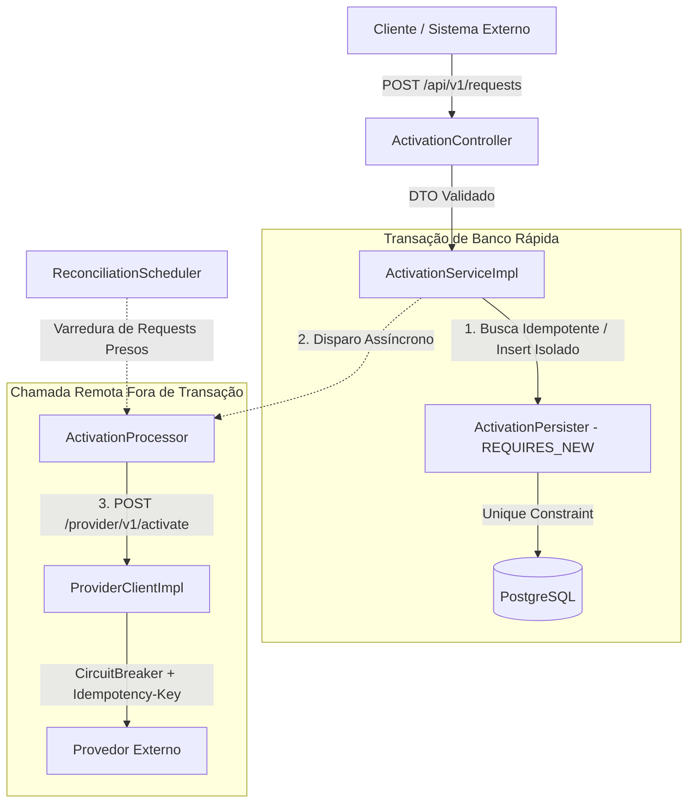
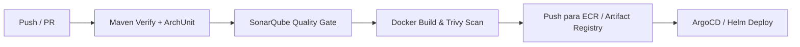

# Product Activation Service

[](https://github.com/WallanDavid/desafio/actions/workflows/ci.yml)
-orange.svg)


Microsserviço de **Ativação de Produtos de Clientes** desenvolvido para o processo seletivo **Java Developer Pleno/Sênior** conduzido pela **Deroyque IT Consulting Services**.

A solução contempla o registro resiliente de solicitações, consulta de status com paginação e filtros, garantia de idempotência estrita contra duplicidade concorrente, e integração assíncrona desacoplada com provedor externo via **Circuit Breaker** e máquina de estados determinística.

---

## Índice
1. [Visão Geral da Arquitetura](#visão-geral-da-arquitetura)
2. [Stack Tecnológica](#stack-tecnológica)
3. [Como Executar](#como-executar)
   - [Opção 1: Via Docker Compose (Recomendado)](#opção-1-via-docker-compose-aplicação--banco--mock-do-provedor)
   - [Opção 2: Localmente via Maven Wrapper](#opção-2-localmente-via-maven-wrapper-h2-em-memória)
4. [Execução da Suíte de Testes](#execução-da-suíte-de-testes)
5. [Documentação da API e Endpoints](#documentação-da-api-e-endpoints)
6. [Decisões Técnicas de Engenharia](#decisões-técnicas-de-engenharia)
   - [Estratégia contra Duplicidade e Idempotência](#1-estratégia-contra-duplicidade-e-idempotência-item-3)
   - [Separação de Transação de Banco x Chamada Remota](#2-separação-de-transação-de-banco-x-chamada-remota-item-5)
   - [Matriz de Integração com o Provedor Externo](#3-matriz-de-integração-com-o-provedor-externo-item-5)
   - [Máquina de Estados e Bloqueio Otimista](#4-máquina-de-estados-e-bloqueio-otimista-version)
   - [Tratamento Padronizado de Erros (RFC 9457 Problem Details)](#5-tratamento-padronizado-de-erros-rfc-9457-problem-details)
   - [Modelo de Segurança (OAuth 2.0 / JWT)](#6-modelo-de-segurança-oauth-20--jwt-item-7)
7. [Cenário de Análise em Produção (Item 10)](#cenário-de-análise-em-produção-item-10)
8. [Operação em Produção e Nuvem](#operação-em-produção-e-nuvem)
9. [Pontos Pendentes e Melhorias Futuras](#pontos-pendentes-e-melhorias-futuras)
10. [Uso de Ferramentas de IA](#uso-de-ferramentas-de-ia)

---

## Visão Geral da Arquitetura

O sistema foi arquitetado seguindo os princípios de **Clean Code**, **SOLID** e separação de responsabilidades em camadas, verificado estritamente via testes arquiteturais com **ArchUnit**:

```
com.wallan.activation
├── config/         # Configurações (Security, RestClient, Async, OpenAPI, Filters)
├── domain/         # Entidades JPA, Enums de Estado e Repositórios
│   └── exception/  # Exceções especializadas de domínio
├── dto/            # Records imutáveis para tráfego na API e comunicação externa
├── service/        # Regras de negócio, cliente HTTP e orquestração assíncrona
└── web/            # Controllers REST e GlobalExceptionHandler (RFC 9457)
```



---

## Stack Tecnológica

| Componente | Tecnologia | Justificativa |
| :--- | :--- | :--- |
| **Linguagem** | **Java 17 (LTS)** | Uso de recursos modernos: `record` para DTOs imutáveis, `switch` com pattern matching, text blocks. |
| **Framework** | **Spring Boot 3.3.5** | Padrão corporativo robusto: Spring MVC, Spring Data JPA, Spring Security 6. |
| **Banco de Dados** | **PostgreSQL 16** / H2 | Relacional com ACID estrito, índices parciais e suporte a constraint única. |
| **Migrações** | **Flyway 10** | Controle versionado e rastreável da evolução do schema do banco. |
| **Resiliência** | **Resilience4j 2.2** | Implementação de Circuit Breaker com fail-fast e Retry exponencial. |
| **Cliente HTTP** | **RestClient (Spring 6)** | Cliente HTTP síncrono moderno com timeouts agressivos de conexão e leitura. |
| **Segurança** | **OAuth 2.0 Resource Server** | Validação stateless de tokens JWT com autorização granular por escopos. |
| **Observabilidade** | **Actuator + Prometheus + MDC** | Probes de *liveness/readiness*, métricas Micrometer e rastreamento via CorrelationId. |
| **Testes** | **JUnit 5, Mockito, AssertJ, WireMock, ArchUnit** | Cobertura integral: testes unitários de domínio, integração WebMvc, concorrência e mocks. |

---

## Como Executar

### Pré-requisitos
- **Docker** e **Docker Compose** instalados (opção 1), OU
- **Java 17 JDK** instalado (opção 2). Não é necessário ter o Maven instalado globalmente, pois o projeto inclui o **Maven Wrapper (`./mvnw`)**.

---

### Opção 1: Via Docker Compose (Aplicação + Banco + Mock do Provedor)
Esta é a forma mais simples e completa de testar todo o ecossistema integrado:

```bash
# 1. Clone o repositório
git clone https://github.com/WallanDavid/desafio.git
cd desafio

# 2. Suba todos os contêineres em segundo plano
docker compose up -d --build

# 3. Verifique se todos os contêineres estão saudáveis
docker compose ps
```

Os serviços estarão disponíveis nos seguintes endereços:
- **Aplicação REST:** `http://localhost:8080`
- **Swagger UI (OpenAPI):** `http://localhost:8080/swagger-ui.html`
- **Actuator Health (Liveness/Readiness):** `http://localhost:8080/actuator/health`
- **Mock do Provedor Externo (WireMock):** `http://localhost:8089`

Para derrubar o ambiente:
```bash
docker compose down -v
```

---

### Opção 2: Localmente via Maven Wrapper (H2 em memória)
Para desenvolvimento ágil sem necessidade de subir contêineres locais:

```bash
# No Linux/macOS:
./mvnw spring-boot:run -Dspring-boot.run.profiles=local

# No Windows (PowerShell/CMD):
.\mvnw.cmd spring-boot:run -Dspring-boot.run.profiles=local
```

A aplicação subirá na porta `8080` utilizando banco H2 em memória com compatibilidade PostgreSQL e migrations Flyway aplicadas automaticamente.

---

## Execução da Suíte de Testes

A suíte de testes contempla **39 testes automatizados** distribuídos entre testes de unidade de domínio, serviços, controladores WebMvc, integração de segurança, testes de concorrência multithread, integração HTTP com WireMock e regras arquiteturais de camadas com ArchUnit:

```bash
# Executa todos os testes e validações arquiteturais
./mvnw clean test

# No Windows:
.\mvnw.cmd clean test
```

### Categorias de Testes Implementadas:
1. **Domínio (`ActivationRequestTest`):** Testes unitários puros sem Spring. Validações determinísticas da máquina de estados, transições permitidas e bloqueio de transições proibidas (ex: de `COMPLETED` para `PROCESSING`).
2. **Serviço (`ActivationServiceImplTest`):** Testes com Mockito para validação de fluxos de idempotência, divergência de payload e captura de violação de chave única.
3. **Web / REST (`ActivationControllerTest`):** MockMvc validando contratos HTTP, validações Jakarta Bean Validation, header `Location` no 201 Created e tratamento ProblemDetail (RFC 9457).
4. **Segurança (`SecurityIntegrationTest`):** Validação de autenticação e autorização via JWT, cobrindo `401 Unauthorized` e `403 Forbidden` para escopos insuficientes.
5. **Concorrência (`DuplicityConcurrencyIntegrationTest`):** Teste multithread real com `CountDownLatch` e `ExecutorService`. Dispara 10 requisições simultâneas com o mesmo `externalId` no mesmo milissegundo e atesta que **exatamente 1 registro** é gravado no banco, 1 chamada recebe 201 e 9 chamadas recebem 200 OK de forma limpa.
6. **Integração com WireMock (`ProviderClientIntegrationTest`):** Simulação de todos os cenários do provedor externo (200 Sucesso, 400 Bad Request, 500 Server Error, 504 Timeout e 429 Rate Limit com `Retry-After`).
7. **Arquitetura (`ArchitectureTest`):** Regras ArchUnit garantindo que a camada de domínio e serviço não dependam da camada web e que controllers não acessem repositórios diretamente.

---

## Documentação da API e Endpoints

### 1. Criar Solicitação de Ativação
`POST /api/v1/requests`
- **Escopo OAuth2:** `SCOPE_activation:write`
- **Header Opcional:** `X-Correlation-Id: <uuid>`

**Payload da Requisição:**
```json
{
  "externalId": "EXT-12345",
  "customerId": "CUST-10001",
  "productCode": "INTERNET-500"
}
```

**Respostas:**
- **`201 Created`:** Nova solicitação registrada. Inclui header `Location: /api/v1/requests/{id}`.
- **`200 OK`:** Retry legítimo com mesmo `externalId` e mesmo conteúdo (idempotência). Retorna o registro existente.
- **`400 Bad Request`:** Falha de validação dos campos obrigatórios (ProblemDetail).
- **`409 Conflict`:** Conflito: o `externalId` já foi utilizado com outro cliente ou outro produto.

**Exemplo de Resposta de Sucesso (201 / 200):**
```json
{
  "id": "0b7f3c1e-5d2a-4c4e-9a51-2f8d7b1e6c90",
  "externalId": "EXT-12345",
  "customerId": "CUST-10001",
  "productCode": "INTERNET-500",
  "status": "PENDING",
  "createdAt": "2026-10-28T14:03:11Z",
  "updatedAt": "2026-10-28T14:03:11Z"
}
```

---

### 2. Consultar Solicitação por ID
`GET /api/v1/requests/{id}`
- **Escopo OAuth2:** `SCOPE_activation:read`

**Respostas:**
- **`200 OK`:** Retorna a solicitação e seu status atual (`PENDING`, `PROCESSING`, `COMPLETED`, `FAILED`).
- **`404 Not Found`:** Solicitação não encontrada para o UUID informado (ProblemDetail).

---

### 3. Listagem Paginada com Filtros
`GET /api/v1/requests?status=COMPLETED&customerId=CUST-10001&page=0&size=20&sort=createdAt,desc`
- **Escopo OAuth2:** `SCOPE_activation:read`
- **Parâmetros:**
  - `status` (opcional): Filtro por estado (`PENDING`, `PROCESSING`, `COMPLETED`, `FAILED`).
  - `customerId` (opcional): Filtro por identificador de cliente.
  - `page`, `size`, `sort`: Parâmetros padrão de paginação do Spring Data.

**Justificativa dos Índices de Banco de Dados:**
Para garantir consultas sub-milissegundo em tabelas com milhões de registros, foram criados no Flyway:
- `idx_activation_requests_customer_id`: Otimiza a busca por cliente.
- `idx_activation_requests_status`: Acelera a filtragem pelo ciclo de vida.
- `idx_activation_requests_created_at`: Garante ordenação temporal descendente eficiente sem necessidade de sort em memória (*filesort*).
- `idx_activation_requests_reconciliation (status, updated_at)`: Índice composto utilizado pelo agendador de reconciliação para localizar registros travados em `PENDING`/`PROCESSING`.

---

## Decisões Técnicas de Engenharia

### 1. Estratégia contra Duplicidade e Idempotência (Item 3)
*Por que verificar no banco com `findByExternalId` e depois inserir não é suficiente?*
- Em cenários de alta concorrência com múltiplas instâncias ou requisições paralelas chegando quase ao mesmo tempo, duas threads executam a leitura antes que qualquer uma tenha feito o `INSERT`. Ambas encontram o resultado vazio e ambas tentam persistir.
- **Nossa Abordagem:**
  1. Constraint física `UNIQUE (external_id)` no PostgreSQL como garantia atômica definitiva a nível de storage engine.
  2. A tentativa de inserção é executada em transação isolada com `Propagation.REQUIRES_NEW` via `ActivationPersister`. Caso ocorra colisão concorrente de chave única (`DataIntegrityViolationException`), a transação principal **não é corrompida** com status `rollback-only`.
  3. A thread intercepta a colisão, recupera o registro comitado pela thread concorrente e avalia o payload:
     - **Mesmo payload (retry legítimo):** Responde com `200 OK` retornando o registro existente.
     - **Payload divergente:** Responde com `409 Conflict` (ou 422) informando que o `externalId` já está em uso por outro produto/cliente.

Consulte o [ADR 002](docs/adr/002-estrategia-duplicidade-idempotencia.md) para o registro completo de decisão.

---

### 2. Separação de Transação de Banco x Chamada Remota (Item 5)
*Por que chamadas HTTP nunca devem ocorrer dentro de um `@Transactional` aberto?*
- Quando uma chamada externa de rede (que pode demorar 2 a 3 segundos) é realizada com uma transação de banco aberta, a conexão com o pool (HikariCP) fica retida ociosa esperando a rede.
- Sob carga moderada, todo o pool de conexões se esgota rapidamente, causando indisponibilidade geral em cascata para todos os outros endpoints do sistema.
- **Nossa Abordagem:**
  1. A solicitação é salva no banco no estado `PENDING` em transação relacional ultrarrápida (< 5 ms) e imediatamente comitada.
  2. O processamento da chamada remota é despachado assincronamente via `ActivationProcessor` em pool de threads dedicado, **100% fora de qualquer transação de banco de dados**.
  3. Somente após a conclusão da resposta do provedor é que uma nova transação pontual é aberta para atualizar o status final.
  4. Para garantir que nenhuma solicitação se perca caso a aplicação sofra crash ou reboot entre o commit e a chamada, o `ReconciliationScheduler` varre solicitações presas e as reprocessa com segurança enviando o cabeçalho `Idempotency-Key: {id}`.

Consulte o [ADR 001](docs/adr/001-arquitetura-e-separacao-transacao-chamada-remota.md) para detalhes.

---

### 3. Matriz de Integração com o Provedor Externo (Item 5)

| Retorno do Provedor | Novo Status | Nova Tentativa? | Justificativa |
| :--- | :--- | :--- | :--- |
| **Sucesso (2xx)** | `COMPLETED` | **Não** | Ativação confirmada pelo parceiro. Protocolo persistido no banco. |
| **HTTP 400 (Bad Request)** | `FAILED` | **Não** | Falha de validação ou inconsistência cadastral. Reenviar repetirá a mesma rejeição. |
| **HTTP 500 / 502 / 503** | Mantém `PROCESSING` / Reagenda | **Sim** (até 3 tentativas) | Erro transitório de infraestrutura externa. Retentado com backoff exponencial. |
| **Timeout de Conexão / Leitura** | Mantém `PROCESSING` | **Sim** (com `Idempotency-Key`) | O provedor pode ter ativado antes da perda do socket. A chave de idempotência protege contra dupla ativação física. |
| **HTTP 429 / 503 com `Retry-After`** | Mantém `PROCESSING` | **Sim** (respeitando intervalo) | Provedor sobrecarregado. Respeita-se a cadência solicitada pelo parceiro para evitar *thundering herd*. |

- **Timeouts Explícitos:** Connect Timeout de 2000 ms e Read Timeout de 3000 ms configurados no `RestClient`.
- **Circuit Breaker:** Resilience4j configurado para abrir o circuito caso a taxa de falha exceda 50% em 10 chamadas, evitando degradação por saturação de conexões externas.

Consulte o [ADR 003](docs/adr/003-resiliencia-integracao-provedor.md) para detalhes.

---

### 4. Máquina de Estados e Bloqueio Otimista (@Version)
- A entidade `ActivationRequest` controla suas transições através de métodos de domínio (`startProcessing()`, `complete()`, `fail()`), impedindo manipulação arbitrária de setters.
- Estados terminais (`COMPLETED` e `FAILED`) rejeitam transições subsequentes, lançando `InvalidStatusTransitionException`.
- A coluna `version` (`@Version`) implementa **Lock Otimista**, garantindo que atualizações concorrentes lancem `OptimisticLockException` em vez de sofrerem perda de escrita (*lost updates*).

---

### 5. Tratamento Padronizado de Erros (RFC 9457 Problem Details)
Todas as falhas retornadas pela API adotam o formato oficial `application/problem+json` suportado nativamente pelo Spring 6:

```json
{
  "type": "https://api.exemplo.com/problems/validation-error",
  "title": "Dados inválidos",
  "status": 400,
  "detail": "Um ou mais campos não passaram na validação.",
  "instance": "/api/v1/requests",
  "traceId": "912033e1-b6ee-4f2f-8a9e-1c10436171ba",
  "errors": [
    { "field": "customerId", "message": "customerId é obrigatório" }
  ]
}
```
- **Rastreabilidade:** O identificador `traceId` é propagado em todos os logs através do MDC do SLF4J via `CorrelationIdFilter`.
- **Segurança da Informação:** Nenhum stack trace interno ou detalhe de banco é exposto aos clientes externos.

---

### 6. Modelo de Segurança (OAuth 2.0 / JWT) (Item 7)
- **Fluxo:** OAuth 2.0 **Client Credentials** para comunicação Machine-to-Machine (M2M).
- **Validação de JWT:** Validação assimétrica via endpoint JWKS (`/.well-known/jwks.json`) conferindo assinatura criptográfica, emissor (`iss`), audiência (`aud`) e expiração (`exp`).
- **Segregação de Escopos:**
  - `POST /api/v1/requests` -> Requer `SCOPE_activation:write`
  - `GET /api/v1/requests/**` -> Requer `SCOPE_activation:read`
- **Respostas de Erro:** Falhas de autenticação e autorização são capturadas pelo `customAuthenticationEntryPoint` e `customAccessDeniedHandler`, retornando `401 Unauthorized` e `403 Forbidden` no padrão ProblemDetail.
- **Gestão de Segredos:** Credenciais para chamada ao provedor parceiro são gerenciadas via variáveis de ambiente e serviços de segredos em nuvem (AWS Secrets Manager / Vault), com rotação dinâmica sem rebuild de imagem.

Consulte o [ADR 004](docs/adr/004-modelo-seguranca-oauth2-jwt.md) para detalhes.

---

## Cenário de Análise em Produção (Item 10)

Após a aplicação entrar em produção, usuários relatam lentidão com os seguintes indicadores monitorados:
- **Tempo médio da API:** subiu de **300 ms → 2,5 s**
- **CPU:** **45%** (estável)
- **Memória:** **60%** (estável)
- **Algumas consultas no banco:** subiram de **50 ms → 1,2 s**
- **Serviço externo:** subiu de **400 ms → 3 s**

### 1. O que você investigaria primeiro?
A primeira ação é investigar a **latência do serviço externo (400 ms → 3 s)** em correlação com o tempo de retenção de threads e conexões no pool de banco de dados (HikariCP). Como CPU (45%) e Memória (60%) estão baixos/saudáveis, o problema não é saturação computacional ou vazamento de memória (leak), mas sim threads bloqueadas aguardando I/O síncrono.

### 2. Como identificaria se o problema está na aplicação, no banco ou na integração externa?
Através do rastreamento distribuído (**Distributed Tracing via OpenTelemetry/Jaeger/APM**):
- Cada requisição possui uma árvore de *spans* contendo a duração de cada trecho:
  - Duração da execução do código Java (Aplicação).
  - Tempo gasto na execução de queries SQL e tempo de espera para obter conexão do pool Hikari (Banco).
  - Tempo de espera na requisição HTTP externa (Provedor).
- Se o span da chamada HTTP ao provedor aumentou de 400 ms para 3 s e representa 85% do tempo total da requisição, a causa primária é a **integração externa**.
- Se as queries no banco subiram de 50 ms para 1,2 s sem aumento no volume de dados, isso indica **espera por conexões do pool** (*connection acquisition wait time*) ou contenção de locks de linha (*row-level locks*) gerados por transações abertas durante a espera do parceiro.

### 3. Quais logs ou métricas seriam úteis?
- **Métricas do HikariCP:**
  - `hikaricp.connections.active`: quantidade de conexões atualmente em uso.
  - `hikaricp.connections.pending`: threads aguardando conexão no pool (se estiver alto, confirma pool starvation).
  - `hikaricp.connections.acquire.duration`: tempo para obter uma conexão.
- **Métricas do Cliente HTTP / Resilience4j:**
  - `activation.provider.call.duration`: percentis p95 e p99 da latência do provedor.
  - `resilience4j.circuitbreaker.state`: taxa de falhas e estado do circuito.
- **Métricas da JVM:**
  - `jvm.threads.live` e contagem de threads em estado `WAITING` / `TIMED_WAITING`.
- **Logs estruturados com TraceId / CorrelationId:**
  - Análise dos logs correlacionados para identificar se as requisições lentas compartilham o mesmo provedor ou mesmo endpoint.

### 4. Que tipo de melhoria poderia ser considerada?
1. **Desacoplamento Assíncrono Completo:** Garantir que o endpoint `POST /api/v1/requests` nunca aguarde a chamada remota de forma síncrona, retornando imediatamente `202 Accepted` ou `201 Created` e processando a integração em background.
2. **Separação de Transação e I/O de Rede:** Garantir que nenhuma transação com o PostgreSQL permaneça aberta durante o I/O do provedor externo.
3. **Ajuste de Timeouts e Circuit Breaker:** Reduzir o Read Timeout do cliente HTTP para 2-3 segundos e configurar o Circuit Breaker para abrir e fazer *fail-fast* quando o parceiro degradar.
4. **Isolamento de Pools:** Pool de conexões do banco de dados e pool de threads HTTP configurados de forma independente.

### 5. Diferencial: Os três sintomas podem ter uma causa comum? Descreva uma hipótese e como a confirmaria.
- **Hipótese de Causa Raiz Comum (Pool Starvation / Contenção Transacional):**
  A aplicação estava executando a chamada HTTP remota **dentro de um bloco transacional `@Transactional` aberto**. Quando o serviço externo ficou lento (400 ms → 3 s), as conexões de banco de dados permaneceram retidas durante 3 segundos por transação. O pool do HikariCP esgotou-se rapidamente, e as consultas do banco — que normalmente demoravam 50 ms — passaram a demorar 1,2 s simplesmente porque ficavam mais de 1,1 s enfileiradas esperando uma conexão livre no pool. Como as threads passavam a maior parte do tempo bloqueadas esperando o socket de rede, a CPU permaneceu baixa (45%).
- **Como confirmar:**
  Analisar a métrica `hikaricp.connections.acquire.duration`. Se o tempo para alocar a conexão no pool saltou de 1 ms para 1.150 ms enquanto a query efetiva no Postgres executou em 5 ms (verificado via `pg_stat_statements`), a hipótese está 100% confirmada.

### 6. Diferencial: Como você validaria que a correção funcionou depois de publicada?
1. **Canary / Blue-Green Deployment:** Publicar a nova versão para uma fração do tráfego (10%) e monitorar os dashboards.
2. **Métricas de Latência (Percentis):** Validar se o p95 e p99 da API retornaram para o patamar basal (< 300 ms).
3. **Métricas do Pool:** Verificar se `hikaricp.connections.pending` caiu para 0 e o tempo de aquisição de conexão normalizou para < 2 ms.
4. **Teste de Carga / Chaos Engineering:** Executar teste de estresse simulando aumento artificial de latência no mock do provedor para 4 segundos e certificar-se de que a latência da API e as consultas ao banco continuam rápidas e desacopladas.

---

## Operação em Produção e Nuvem

### 1. Dockerfile Otimizado
- **Multi-Stage Build:** Separa o estágio de compilação (JDK) do runtime de produção (JRE Alpine), gerando imagem enxuta e segura.
- **Spring Boot Layertools:** Camadas divididas entre dependências, loader e aplicação, permitindo cache otimizado no Docker registry.
- **Usuário Não-Root (`spring:spring`):** Em conformidade com o CIS Docker Benchmark e políticas restritivas de Pod Security Standards (PSS) no Kubernetes.
- **JVM Flags para Contêiner:**
  - `-XX:+UseContainerSupport`: Respeita os limites de CPU e memória do contêiner.
  - `-XX:MaxRAMPercentage=75.0`: Aloca até 75% da memória limite do contêiner para o heap.
  - `-XX:+ExitOnOutOfMemoryError`: Garante que o pod reinicie imediatamente em caso de OOMKilled, evitando comportamento zumbi.

---

### 2. Microsserviços e Arquitetura Cloud (Diferenciais)

#### A. Múltiplas Instâncias Concorrentes
- A aplicação é **100% Stateless**, permitindo Horizontal Pod Autoscaler (HPA) baseado em CPU e latência.
- A regra de unicidade do `externalId` é garantida no PostgreSQL através da constraint única no banco de dados. Caso seja necessário orquestração distribuída adicional, pode-se adotar locks distribuídos via **Redis (Redlock)** ou **ShedLock** para o agendador de reconciliação.

#### B. Segredos e Configurações
- Configurações agnósticas via `ConfigMaps` injetadas como variáveis de ambiente.
- Credenciais sensíveis e tokens gerenciados via **AWS Secrets Manager**, **HashiCorp Vault** ou **GCP Secret Manager**, sincronizados no Kubernetes via **External Secrets Operator (ESO)**.

#### C. Mensageria para Notificação de Ativação
- Para notificar outros microsserviços (ex: Billing, Notificações, CRM) de que uma ativação foi concluída, adota-se publicação de eventos em tópicos **Apache Kafka** ou **RabbitMQ** utilizando o padrão **Transactional Outbox Pattern** com **Debezium (Change Data Capture - CDC)** para garantia de entrega *at-least-once* sem risco de inconsistência em caso de falha de rede.

#### D. Pipeline de CI/CD até Produção


---

## Pontos Pendentes e Melhorias Futuras

Caso o projeto evoluísse para escala massiva em produção corporativa, os seguintes refinamentos seriam implementados:

1. **Transactional Outbox Pattern com Kafka:**
   Substituir o agendador de polling por uma tabela de outbox transacional lida pelo Debezium para streaming de eventos de ativação com latência de milissegundos.
2. **Cache Distribuído de Idempotência com Redis:**
   Implementar um filtro de admissão com Redis e chave de idempotência com TTL de 24 horas, aliviando o banco de dados relacional de consultas repetidas de retry.
3. **Tracing Distribuído Nativo (OpenTelemetry):**
   Adicionar o agente do OpenTelemetry para exportação automática de traces para o Grafana Tempo ou Jaeger.
4. **Rate Limiting por Tenant (Token Bucket):**
   Implementar limitação de taxa por cliente via Redis (Spring Cloud Gateway ou Bucket4j) para prevenir ataques de negação de serviço e abuso de chamadas.

---

## Uso de Ferramentas de IA

Conforme recomendado no enunciado do desafio técnico, declara-se a utilização de assistente de inteligência artificial durante o desenvolvimento deste projeto:
- **Áreas de Utilização:** Auxílio na geração inicial de boilerplate de testes e documentação de apoio.
- **Validação e Tomada de Decisão:** Toda a modelagem de domínio, arquitetura de separação de transações, estratégia de resiliência e concorrência em banco de dados, matriz de decisão técnica e respostas aos cenários de produção foram rigorosamente projetadas, revisadas e validadas conforme os requisitos do desafio técnico para o nível Pleno/Sênior.

---

## Autor
**Wallan Peixoto**  
- **Email:** bobwallan2@gmail.com  
- **GitHub:** [https://github.com/WallanDavid/desafio](https://github.com/WallanDavid/desafio)
